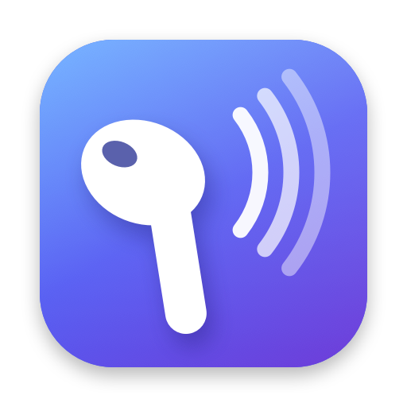

<p align="center"></p>

# BudDial

Type with your voice by holding an AirPod.

Take an AirPod out, cover its sensor with a fingertip and talk. Let go, and your words appear at the cursor, in any app. Speech becomes text on your Mac; nothing is uploaded.

<p align="center"></p>

| Gesture | What it does |
|---|---|
| **Hold and talk** | Cover a bud's sensor and speak. Let go to paste the text at your cursor. |
| **Tap** | Press Return, to send a message. |
| **Hold silently** | Cover the bud for a second without talking to remove the last dictation. Repeat to remove the one before. |

While both AirPods are in your ears, BudDial leaves them alone. While you hold a bud, the pill at the bottom of the screen says what letting go will do: **Release to send**, **Listening**, or **Release to undo**.

**Voice commands** work when they start what you say:

| Say | What happens |
|---|---|
| "Spotlight Claude Code" | Opens Spotlight and types "Claude Code". Tap to open the result. |
| "Scratch that" | Removes the last dictation. |
| "New line" | A line break that does not send. |

## Install

1. Download `BudDial.zip` from the latest release, unzip it and move BudDial to Applications.
2. Open it. Builds are not notarized yet, so macOS blocks the first launch: open System Settings → Privacy & Security, scroll down and click **Open Anyway**.
3. The welcome guide does the rest: microphone and Accessibility permissions, choosing your AirPods, a short practice, and a one-time download of the speech model (about 550 MB).

BudDial lives in the menu bar (the AirPods icon). Settings, Disable and Quit are there.

**Requirements:** macOS 26 or later on Apple Silicon, and AirPods with automatic ear detection. Tested with AirPods 4.

## Privacy

- The Mac's microphone records while you hold a bud. With **Instant start** on, the last few seconds stay in memory so your first words aren't cut off, and macOS shows its orange microphone dot.
- Speech is transcribed on your Mac by [whisper.cpp](https://github.com/ggml-org/whisper.cpp). Nothing is sent anywhere.
- To spell names right, BudDial reads up to 300 characters before your cursor and gives them to the local speech model. Turn this off in Settings with **Use text before the cursor**.
- The event log records timings, never what you said.
- The only network access is the one-time model download from Hugging Face.

## Settings

Menu bar icon → Settings… (⌘,): your AirPods (with a live sensor indicator), how long to hold before dictating, tap to send, silent hold deletes, microphone, Instant start, speech model, language, vocabulary (names and terms you say), replacements (fix words it keeps getting wrong, like "clawed code" to "Claude Code"), voice commands, text before the cursor, sounds, and open at login.

## Build from source

```sh
brew install whisper-cpp
./build.sh
```

`build.sh` runs the gesture tests, compiles the app, bundles `whisper-server` and its libraries into it, signs it, and installs it to `~/Applications/BudDial.app`. On first run it creates a local self-signed code-signing identity in `signing/` (macOS asks once to trust it), so the Microphone and Accessibility permissions survive rebuilds. Quit and reopen the app after a build.

Useful launch flags:

- `--onboarding` shows the welcome guide again.
- `--simulate-sensor` accepts fake input: post the distributed notification `dev.buddial.simulate` with object `cover` or `uncover` (a touch), `benchmark`, `onboarding:<step>` (0 to 4, with `--onboarding`), or `snapshot:<png path>` (renders the guide).

## How it works

AirPods report ear detection to macOS's Bluetooth daemon. BudDial reads that daemon's log for your AirPods, so a fingertip on the sensor of a bud in your hand looks like "in ear". The touch shape decides the gesture, the built-in microphone records (including the moment before the touch), and a bundled whisper.cpp server, kept warm, turns the take into text in about 0.2 s. Measurements, limits and the benchmark are in [docs/how-it-works.md](docs/how-it-works.md).

App data lives in `~/Library/Application Support/BudDial`.

## Uninstall

Quit BudDial, delete the app and `~/Library/Application Support/BudDial`, and remove BudDial from System Settings → Privacy & Security → Microphone and Accessibility.

## Artwork

`tools/make_icon.sh` draws the app icon (`src/AppIcon.icns`, `docs/icon.png`). `tools/make_demo_gif.sh` renders the welcome animation to `docs/demo.gif` (needs `ffmpeg`).
