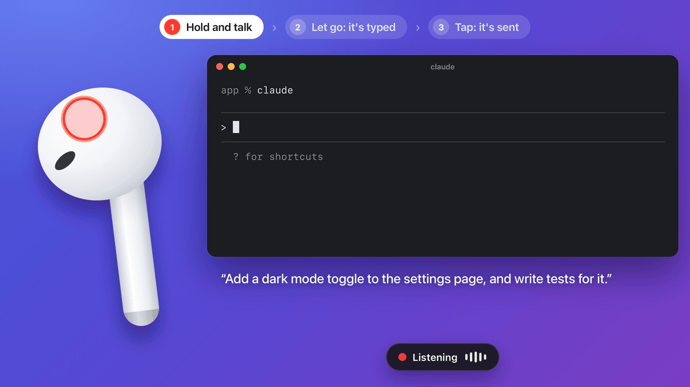

<p align="center"></p>

<h1 align="center">BudDial</h1>

<h3 align="center">Prompt Claude Code, Codex and ChatGPT by holding an AirPod.</h3>

<p align="center">Hold a bud and talk. Let go, and your prompt is typed. Tap, and it's sent.<br>
No keyboard, no hotkey, and nothing you say leaves your Mac.</p>

<p align="center"></p>

## Install

```sh
brew install --cask teshnizi/tap/buddial
```

Then open BudDial from Applications. A short guide asks for microphone and Accessibility access, finds your AirPods, and has you try each gesture once.

Needs a Mac with Apple silicon on macOS 26 or later, and AirPods with automatic ear detection (tested with AirPods 4). No Homebrew? [Download the app](docs/install.md#download-the-app) or [build it yourself](docs/install.md#build-from-source).

## Why BudDial

Prompts are easier to say than to type, but dictation usually keeps you at the keyboard: a hotkey to start, another to stop, Return to send. BudDial puts all of it on the AirPod in your hand, so you can lean back, think out loud, and send.

- **The AirPod is the button.** Cover its ear sensor with a fingertip and BudDial listens. No hotkey, no extra hardware.
- **Made for prompts.** A tap presses Return. A quiet one-second hold takes back what you just said.
- **Fast and private.** Whisper turns your speech into text on your Mac, about half a second after you let go.
- **Learns your words.** Add names like Claude Code or Supabase, and fixes like "cloud code" → "Claude Code".
- **Works in any app.** It types wherever your cursor is: Claude, Terminal, ChatGPT, Slack, Notes.

## Using it

Take one AirPod out and hold it like a button. Keep the other one in if you like.

| Gesture | What happens |
|---|---|
| **Hold and talk** | When you let go, what you said is typed at your cursor. |
| **Tap** | Presses Return to send it. |
| **Hold for a second, silently** | Removes the last thing you said. Again for the one before. After 4 seconds it just keeps listening, so pausing to think never deletes anything. |

While you hold the bud, a pill at the bottom of the screen shows what letting go will do. Talk toward your Mac: its microphone does the listening, and the AirPod is only the button.

You can also say **"Scratch that"** to remove the last dictation, **"New line"** for a line break, or **"Spotlight"** and a name to search for it ("Spotlight Notion", then tap to open).

## Questions

<details>
<summary><b>Why does the Mac listen instead of the AirPod?</b></summary>
<br>
Using AirPods as a microphone switches them to phone-call sound quality while they listen. The Mac's own microphone avoids that and is always ready, so your first word isn't cut off.
</details>

<details>
<summary><b>Do I have to take an AirPod out?</b></summary>
<br>
Yes. While both AirPods are in your ears, BudDial leaves them alone, so music and calls work as usual. Take one out to use it as the button.
</details>

<details>
<summary><b>Which AirPods work?</b></summary>
<br>
AirPods with automatic ear detection should work. BudDial is tested with AirPods 4.
</details>

<details>
<summary><b>Does anything leave my Mac?</b></summary>
<br>
No. Speech becomes text on your Mac with <a href="https://github.com/ggml-org/whisper.cpp">whisper.cpp</a>. The only download is the speech model, about 550 MB, once, from Hugging Face. Audio stays in memory and is dropped unless you are holding a bud. To spell names right, BudDial gives the speech model up to 300 characters before your cursor; turn that off in Settings (<b>Use text before the cursor</b>). The event log records timings, never your words.
</details>

<details>
<summary><b>It got a word wrong.</b></summary>
<br>
Add the word to Settings → Speech → <b>Vocabulary</b> (about 20 words works best), or teach it a fix in <b>Replacements</b>. A quieter room or sitting a little closer helps more than any setting. More tips in <a href="docs/troubleshooting.md">troubleshooting</a>.
</details>

<details>
<summary><b>Is it notarized by Apple?</b></summary>
<br>
Not yet. So that BudDial opens without macOS's "Apple could not verify" message, the Homebrew install removes the quarantine flag macOS puts on downloaded apps. The <a href="https://github.com/teshnizi/homebrew-tap/blob/main/Casks/buddial.rb">cask</a> is one short file. If you <a href="docs/install.md#download-the-app">download the app</a> instead, macOS asks you once to allow it.
</details>

<details>
<summary><b>Something isn't working, or I want to uninstall.</b></summary>
<br>
See <a href="docs/troubleshooting.md">troubleshooting</a> and <a href="docs/install.md#uninstall">uninstalling</a>.
</details>

## How it works

AirPods tell macOS when they go in or out of an ear. BudDial watches that signal, so a fingertip on the sensor of a bud in your hand looks like "in ear": that is the button. How long you touch and whether you speak decide the gesture. The Mac's microphone records, including the moment just before your touch, and a speech engine running on your Mac types the result. Details, measurements and known limits: [docs/how-it-works.md](docs/how-it-works.md).

## Development

Building, test hooks, the benchmark and releases: [docs/development.md](docs/development.md).

## License

MIT. See [LICENSE](LICENSE).
